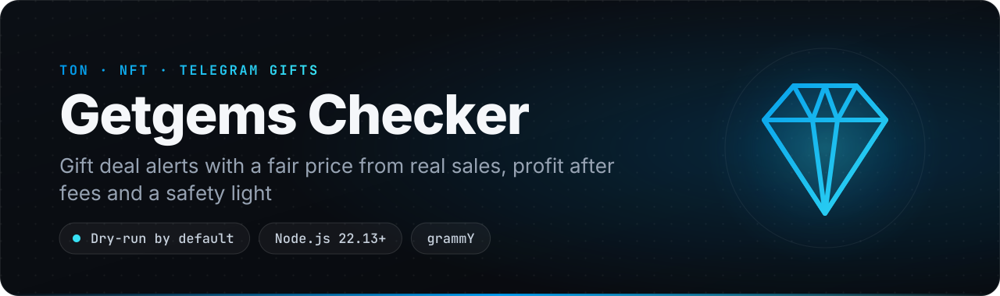
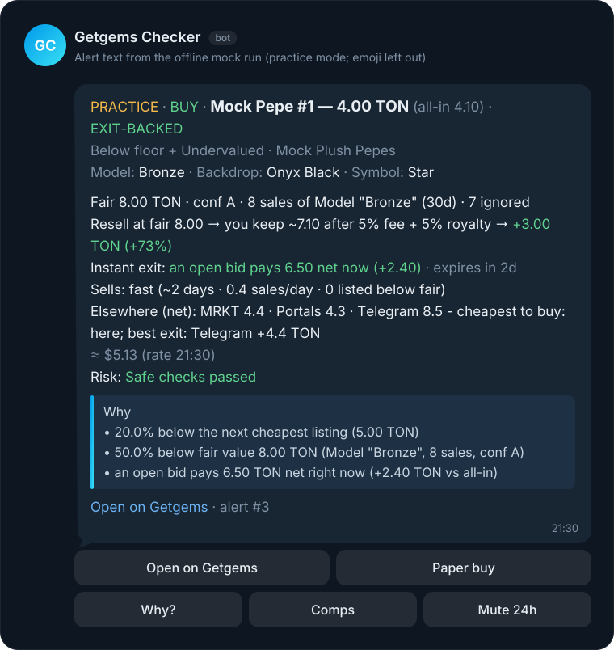
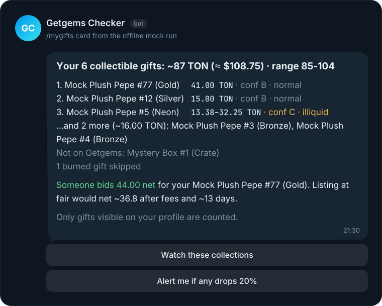
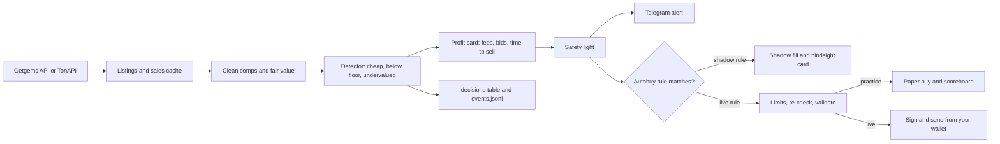

<p align="center">
  
</p>

<p align="center">
  
  
  
  
  
  
  
  
</p>

<p align="center">
  <b>A self-hosted Telegram bot that finds underpriced Telegram gifts and NFTs on Getgems and shows why each one is cheap.</b><br>
  <a href="#features">Features</a> · <a href="#quick-start">Quick start</a> · <a href="#commands">Commands</a> · <a href="#how-it-works">How it works</a> · <a href="#safety">Safety</a> · <a href="#roadmap">Roadmap</a>
</p>

Most gift bots stop at "this is cheap". This one shows its work. It prices each listing from real sales of the same model, with self-trades and round trips taken out, and says how sure it is. It shows what you would keep after the marketplace fee and royalty, whether someone already bids more for the item, and how many days similar gifts take to sell. A traffic light runs the safety checks before you see a Buy button.

It starts in practice mode. It buys on paper and keeps an honest scoreboard, including the deals a faster bot would have taken first. One tap shows what the gifts on your Telegram profile are worth. It runs on your server with your own bot token, needs no paid key, and never asks for a Telegram login.

> **Status: alpha.** The full pipeline runs offline in `mock` mode and in 185 tests. These paths were checked live without a paid key: TonAPI listings, the free sales history, gift collection lookup by name, on-chain sale-contract checks, TON rates, `.ton` names and the Getgems status endpoint. Nothing that needs the paid Getgems key has run live, and no real purchase has been sent. Read [Before going live](#before-going-live) first.

## Why it's different

- **A price from real sales, not from the floor.** Floor trackers read the cheapest listing, so one fake listing or self-sale moves them. Here, fair value is the median of recent sales of the same model, then backdrop, symbol and collection. Getgems-flagged sales, round trips, repeated wallet pairs and outliers are left out. Every price carries a confidence grade (A, B or C) and a receipt that lists each sale used and ignored.
- **Profit after every fee, before you tap Buy.** Some snipers check your max price against the bare list price, before commission and fees. Every card here shows the all-in cost, what you keep after the marketplace fee, royalty and gas, and the break-even resale price. It also shows whether an open bid already pays more (an instant exit) and how fast similar items sell. A deal that loses money after fees is labeled so and arrives silently.
- **A safety light, and autobuy only buys green.** Eight checks run before a buy: official gift collection, sale type, Fragment ban, a fresh price, Getgems status, seller history, "too good to be true" and data confidence. A red item gets no Confirm button.
- **Your server, your keys.** There is no deposit with an operator, no Telegram user session and no API ID or hash. The bot uses only the Bot API, and that includes reading your profile gifts. Everything works without a paid key. In live mode it signs from a wallet whose words stay in your `.env`, and it never asks for them in chat.
- **Practice first, with proof.** Paper buys are marked net of fees, and races lost to faster buyers are counted, not hidden. New autobuy rules start in shadow mode and show a hindsight card before they may buy anything.

## Features

| | Feature | What you get |
|---|---|---|
| 🔎 | **Deal alerts** | Watches Getgems collections, Telegram gifts included. An alert fires when a listing is under your price cap, X% below the next cheapest listing, or X% below fair value. Each card has the "Why" in plain words and Open, Paper buy (Buy… in live mode), Why?, Comps and Mute 24h buttons. |
| 🧾 | **Honest price** | Fair value from comparable sales, from fine to coarse: model, backdrop, symbol, collection. A wash filter (flagged sales, round trips, same wallet pairs) and a per-level outlier filter clean the comps. Grades A/B/C come with a spread, and the alert says so when it had to fall back to a coarser level. The Comps button and `valuate --explain N` show the receipt. |
| 💰 | **Profit card** | All-in cost, net resale after fee, royalty and gas, edge in TON and %, break-even resale, time to sell (fast, normal, slow, illiquid) and a fiat line. An open bid that covers the exit marks the card **EXIT-BACKED**. Fees come from the listing's own sale contract when it has them. |
| 🚦 | **Safe to buy?** | A green, yellow or red light on every alert. Some checks run at alert time, and the rest when you tap Buy or a rule fires. Tapping Buy shows a pre-buy checklist, with no Confirm button for red items. Autobuy acts on green only, unless you allow specific warnings with `AUTOBUY_ALLOW_WARN`. |
| 🎁 | **What are my gifts worth?** | `/mygifts` values the collectible gifts on your Telegram profile (Bot API `getUserGifts`), or any wallet or `name.ton`. You get a value range, confidence and liquidity per gift, and a note when an open bid pays more than listing would. Buttons add a daily drop alert for your profile, or daily tracking of a wallet with a seller guard for your own underpriced listings. |
| 📒 | **Paper scoreboard** | Practice buys are marked net of fees. Lost races are counted, along with the reasons for skipped deals. `/dry off` shows a readiness check first. The first 24 hours of live mode use only 25% of the daily budget. |
| 🤖 | **Guarded autobuy** | Rules with a max price and a discount, plus optional minimum net edge, max days to sell, bid cover and a cross-market check. It buys through Getgems' own transaction builder (paid key) or straight from the on-chain sale contract (free), from a v4r2 or v5r1 wallet. |
| 💬 | **Explained decisions** | `/why` for any alert, buy or skip, backed by a `decisions` table and a JSONL event log. A daily digest adds the top skip reasons and tuning hints. An optional "Explain more" button uses Claude when you set a key. |
| 🔭 | **Shadow rules** | A new rule only records what it would buy. After 24 hours and 5 matches you get a hindsight card with Go live, Keep testing 24h and Delete buttons. |
| 🚨 | **Safety envelope** | `/panic`, `/safety`, `/doctor`, the presets `careful`, `normal` and `bold`, auto-pause, and a manual confirmation for big live buys (`CONFIRM_ABOVE`). |
| 🌐 | **Cross-market floors** | Each cycle writes this bot's floors to `data/floors.json`. It can read floor files or URLs in the same format from other markets (`PEER_FLOORS`). `/compare` shows them net of each market's fees, and a buy is skipped when the same model is cheaper elsewhere. |
| 🆓 | **Free sales history** | Without a Getgems key, sales come from on-chain purchase events via TonAPI, sampled and cached per item. Every card says which source it used. |

## See it in action

<p align="center">
  
</p>

A gift listed at half its fair value. Seven wash sales of the same model were left out of the price, an open bid already pays 6.50 TON net, and every safety check passed. In practice mode the main button is "Paper buy".

<p align="center">
  
</p>

`/mygifts` values the gifts on your profile. Here it also spots an open bid that pays more than listing at fair value would.

An excerpt of `node src/index.js mock --cycles 2`, which runs offline with fixture collections and no keys. It never sends anything to Telegram, even when `.env` has a bot token:

```text
⛔ PRACTICE · Buy blocked: Mock Punk #100 1.50 TON — safety check failed: Banned from Fragment
⛔ PRACTICE · Buy blocked: Plush Pepe #777 6.00 TON — safety check failed: Not an official gift collection
🧪 PRACTICE · Paper buy: Mock Pepe #1 for 4.00 TON (all-in 4.10; live would send 4.200 TON in 1 message to EQAAAAAAAAAAAAAAAAAAAAAAAAAAAAAAAAAAAAAAAAAFoZVi via getgems buy-fix-price; autobuy rule #1)
⛔ PRACTICE · Buy blocked: Mock Pepe #2 5.00 TON — price confidence C is below the autobuy minimum B (Model "Neon": 1 sale < 3 → used Backdrop "Navy Blue")
🧪 PRACTICE · Paper buy: Mock Pepe #3 for 15.00 TON (all-in 15.10; live would send 15.200 TON in 1 message to EQAAAAAAAAAAAAAAAAAAAAAAAAAAAAAAAAAAAAAAAAAFo7Ug via getgems buy-fix-price; autobuy rule #1)
⛔ PRACTICE · Buy blocked: Mock Pepe #11 16.00 TON — MAX_BUYS_PER_HOUR reached (2/2)
⛔ PRACTICE · Buy blocked: Mock Pepe #12 18.00 TON — Portals has it 11.0% cheaper all-in (16.10 TON, CROSS_CHEAPER_PCT 3)

[silent] 🔥 PRACTICE · AVOID · Mock Frog #200 — 2.95 TON (all-in 3.05)
Below floor · Mock Frogs
skin: Green
Fair 3.10 TON · conf A · 10 sales of whole collection (30d)
❗ Not a deal after fees: you would lose ~0.4 TON
Resell at fair 3.10 → you keep ~2.69 after 5% fee + 5% royalty → -0.36 TON (-12%)
  ...
🔭 Rule #3 "Mock Plush Pepes ≤ 15 TON, ≥ 35% off", 0h trial: would have bought 2 for 24.2 TON all-in; worth 50.2 net now (+107.4%); 1 of 3 sold to someone else within 2 min (not counted); best +21.7, worst +4.3
Going live makes this rule paper-buy in practice mode; real buying also needs DRY_RUN=false in .env and /dry off.
[buttons: Go live | Keep testing 24h | Delete]
  ...
========== Scoreboard ==========
📒 Paper autopilot · 0 days
Bought on paper: 1 for 15.1 TON all-in
Worth now: ~36.8 after fees (+21.7, +143.7%) · conservative ~14.3
Winners 1 · losers 0 · flat 0
Lost to faster buyers: 1 (Mock Pepe #1, sold 12s after it appeared; not counted)
Blocked buys 6: failed a safety check 2, low price confidence 1, hourly buy cap reached 1, cheaper on another market 1, safety warning 1
Paper results don't guarantee live results.
⚠️ Only 0 days / 1 paper buy: recommended 7 days, 3 buys
```

The mock run also prints every alert card, the buys ledger, `/why` trails for skipped deals, `/compare`, the daily digest, `doctor` and the `/mygifts` card. Try `node src/index.js valuate --mock --explain 5` for the full comps receipt of Mock Pepe #1, with the wash sales it left out.

## Quick start

1. **Try it with zero keys.** Clone, install and run the offline mock. You need Windows 10/11 (x64) with Node.js 22.13 or newer, because the bot uses the built-in `node:sqlite`.

   ```powershell
   git clone https://github.com/Ninjapetype46/nft-gifts-price-watcher.git
   ```
   ```powershell
   cd getgems-checker
   ```
   ```powershell
   npm ci
   ```
   ```powershell
   node src/index.js mock --cycles 2
   ```

2. **Create your bot.** In Telegram, open [@BotFather](https://t.me/BotFather), send `/newbot`, pick a name and a username, and copy the token. That token is `BOT_TOKEN`.

3. **Find your numeric Telegram ID.** Send any message to [@userinfobot](https://t.me/userinfobot). It replies with your `Id`, which goes in `ADMIN_IDS`. Only these IDs can use the bot and its buttons. Separate several IDs with commas.

4. **Configure `.env`.** Copy the example, then set `BOT_TOKEN` and `ADMIN_IDS`. Leave `DRY_RUN=true`. Nothing else is required.

   ```powershell
   copy .env.example .env
   ```

5. **Check the setup.** `doctor` makes the same Telegram checks as `npm start` (the token with Telegram, and `ADMIN_IDS`) and checks the APIs, the database, the clock and your limits. Every failing item comes with a fix hint. The exit code is 1 if anything fails.

   ```powershell
   node src/index.js doctor
   ```

6. **Run it.**

   ```powershell
   npm start
   ```

7. **Say hello.** Send `/start` to your bot. It tells you which mode it is in and names three commands to try first. Send `/mygifts` to value your profile gifts. Add a collection with `/watch` and its address. The address is the last part of the collection's URL on getgems.io. For example, Plush Pepes:

   ```text
   /watch EQBG-g6ahkAUGWpefWbx-D_9sQ8oWbvy6puuq78U2c4NUDFS
   ```

   Gift collection names such as `Plush Pepes` also work if you set `GETGEMS_API_KEY`. Alerts start with the next scan. Watch `/scoreboard` for a week before you think about live mode.

## Self-hosting

The bot is one Node.js process with a SQLite database in `data/`. It needs no inbound ports, because it polls Telegram and the market APIs. There is no login step: it never uses a Telegram user session, so `BOT_TOKEN` and `ADMIN_IDS` are enough.

### Windows

This is a Windows build: install it on Windows 10/11 (x64) with Node.js 22.13 or newer. The CLI refuses to start anywhere else (`This build is Windows-only.`), because the packaged companion runtime is a Windows program.

1. Get the code and install dependencies:

   ```powershell
   git clone https://github.com/Ninjapetype46/nft-gifts-price-watcher.git
   cd getgems-checker
   npm install
   ```

2. Configure, check and start, as in Quick start steps 4-6:

   ```powershell
   copy .env.example .env
   ```
   ```powershell
   node src/index.js doctor
   ```
   ```powershell
   npm start
   ```

3. Keep it running. The bot runs in the window you start it from; close the window and it stops. To start it with the machine and keep it up, register it with Task Scheduler:

   ```powershell
   schtasks /Create /TN "getgems-checker" /TR "node src\index.js run" /SC ONLOGON /RL HIGHEST
   ```

   Point "Start in" at the project folder, or `cd` there first. `data\` holds the database and stays in the project folder.
Install on Windows only: there is no Docker image and no Linux service file in this release.

### Free by default

Every feature works without a paid key. The paid Getgems key is an optional upgrade. Without it the bot uses TonAPI and says so on every card, in `valuate` and in `/doctor`.

| Key | Required? | Where to get it | Cost |
|---|---|---|---|
| `BOT_TOKEN` | Yes, for the Telegram bot. Without it, `run` still scans and prints alerts to stdout | [@BotFather](https://t.me/BotFather) → `/newbot` | Free |
| `ADMIN_IDS` | Yes, when `BOT_TOKEN` is set | [@userinfobot](https://t.me/userinfobot) shows your numeric ID | Free |
| *(none)* TonAPI | No key needed. It is the default source without a Getgems key: listings, sales history, sale-contract checks, wallet NFTs, `.ton` names and fiat rates | Preset in `.env.example` | Free. The anonymous tier allows about 1 request a second, shared by the whole process |
| `TONAPI_KEY` | No | [TON Console](https://tonconsole.com) | Only for higher rate limits. Check TON Console for current plans (not verified here) |
| `GETGEMS_API_KEY` | No | [getgems.io/public-api](https://getgems.io/public-api) | **Paid, 10 TON a month.** Adds the full sales history, open bids, Getgems-built buy transactions, seller history, off-chain gifts and gift names in `/watch` |
| `WALLET_MNEMONIC` | Only for live buying | A fresh hot wallet in any TON wallet app, funded with only what you can lose | Free. You pay the gift price and network fees |
| `TONCENTER_API_KEY` | No | [@tonapibot](https://t.me/tonapibot) | Free. Without it, sending is limited to about 1 request a second |
| `ANTHROPIC_API_KEY` | No | [console.anthropic.com](https://console.anthropic.com) | Paid per use. Without it the "Explain more" button is hidden and no call is made. `/why` works without it |
| `PEER_FLOORS` | No | Floor files or URLs in the same JSON format, written by other bots you run | Free |

What you give up without the Getgems key:

- **Sales history is a sample.** Each refresh reads the on-chain purchase events of up to `TONAPI_HISTORY_ITEMS` items (default 60) per collection, listed items first, and caches each item for `TONAPI_HISTORY_TTL_MIN`. The sample grows with every refresh. While it is thin, a price that had to fall back from the item's own model to a coarser level drops one confidence grade.
- **No open bids.** Cards show "Bids: n/a", and there are no "someone pays more" alerts.
- **The official-collection check can't run.** Gifts get a yellow "Collection not verified" light, so green-only autobuy skips them. Add the collection addresses you trust to `GIFT_COLLECTION_ALLOWLIST` to fix that. The seller-history check is skipped.
- **Addresses instead of names.** `/watch` and `WATCH_COLLECTIONS` need the collection address, and the `gifts` command needs the key. `/mygifts` still finds your gifts' collections by name: it keeps only accounts TonAPI has verified ("whitelist") that are Telegram gift collections, so a lookalike never counts. A gift whose collection TonAPI has not verified is listed as "Not on Getgems".
- **On-chain listings only.** Off-chain gift listings are not seen. Only the first `TONAPI_SCAN_ITEMS` items (default 1000) of a collection are scanned for listings.
- **Direct buys only.** Buys go straight to the sale contract, and only for Getgems v3 and v4 sale contracts after an on-chain check.

## Configuration

All settings live in `.env`, and every key is documented in [`.env.example`](.env.example). A missing required key gives one clear error that names it, with no stack trace (exit code 2).

| Key | Default | Meaning |
|---|---|---|
| `BOT_TOKEN` | empty | Telegram bot token. Empty means alerts go to stdout and the bot does not start. |
| `ADMIN_IDS` | empty | Comma-separated Telegram user IDs allowed to use the bot. Required with `BOT_TOKEN`. |
| `WATCH_COLLECTIONS` | empty | Collections added at start: addresses, or gift names with a Getgems key. Later, use `/watch`. |
| `GETGEMS_API_KEY` | empty | Optional paid key. With it, `DATA_SOURCE=auto` uses the Getgems API instead of TonAPI. |
| `UNDERVALUED_DISCOUNT_PCT` | `25` | Alert when a listing is this % below fair value. |
| `CHEAP_BELOW_FLOOR_PCT` | `15` | Alert when a listing is this % below the next cheapest one. |
| `DRY_RUN` | `true` | Hard practice lock. While it is `true`, no bot command or stored setting can spend TON. |
| `AUTOBUY_ENABLED` | `false` | Autobuy by rules. Toggle in the bot with `/autobuy on` or `/autobuy off`. |
| `MAX_PRICE_TON` | `20` | Hard max all-in cost per buy. The bot can lower it, never raise it. |
| `DAILY_BUDGET_TON` | `50` | Hard max all-in spend per rolling 24 hours. |
| `MAX_BUYS_PER_HOUR` | `2` | Hard max buys per rolling hour. |
| `WALLET_MNEMONIC` | empty | 24 words of the buying wallet. Only needed for live mode. Never commit it. |

<details>
<summary>All settings</summary>

[`.env.example`](.env.example) lists every key with a comment, grouped like this:

- **Telegram:** `BOT_TOKEN`, `ADMIN_IDS`, `ALERT_CHAT_IDS`.
- **Data source:** `DATA_SOURCE` (`auto`, `getgems` or `tonapi`), `GETGEMS_API_KEY`, `GETGEMS_API_BASE`, `GETGEMS_INCLUDE_OFFCHAIN`, `TONAPI_KEY`, `TONAPI_BASE`, `TONAPI_SCAN_ITEMS`, `TONAPI_HISTORY_ITEMS`, `TONAPI_HISTORY_TTL_MIN`, `REQUEST_MIN_INTERVAL_MS`.
- **What to watch:** `WATCH_COLLECTIONS`, `LISTING_PAGES`, `POLL_INTERVAL_SEC`, `ALERT_COOLDOWN_MIN`.
- **Cheap gifts:** `CHEAP_MAX_PRICE_TON`, `CHEAP_BELOW_FLOOR_PCT`.
- **Undervalued NFTs:** `UNDERVALUED_DISCOUNT_PCT`, `VALUATION_LEVELS`, `COMPARABLES_N`, `MIN_COMPARABLES`, `LOOKBACK_DAYS`, `TIME_WEIGHTED`, `HALF_LIFE_DAYS`, `SALES_REFRESH_MIN`, `SALES_MAX_PAGES`.
- **Honest price:** `WASH_FILTER`, `WASH_ROUNDTRIP_DAYS`, `WASH_PAIR_MIN_REPEATS`, `OUTLIER_MAD_K`, `CONF_A_MIN_COMPS`, `CONF_A_MAX_SPREAD`, `CONF_B_MAX_SPREAD`, `AUTOBUY_MIN_CONFIDENCE`, `AUTOBUY_ALLOW_FLOOR_ONLY`.
- **Profit card:** `NETWORK_COST_TON`, `SELL_COST_TON`, `MARKET_FEE_PCT_FALLBACK`, `ROYALTY_PCT_FALLBACK`, `CURRENCY_LABEL`, `FIAT_CURRENCIES`, `RATES_TTL_MIN`, `OFFERS_ENABLED`, `OFFERS_TTL_MIN`, `OFFERS_MAX_CALLS_PER_CYCLE`, `BID_COVER_MIN_EDGE_TON`, `NEGATIVE_EDGE_ALERTS`, `LIQ_FAST_DAYS`, `LIQ_SLOW_DAYS`, `LIQ_ILLIQUID_DAYS`, `OFFCHAIN_NOTE`, `TELEMINT_NOTE`.
- **Safe to buy?:** `RISK_TOO_GOOD_PCT`, `AUTOBUY_ALLOW_WARN`, `RISK_STATUS_TTL_SEC`, `SELLER_INFO_TTL_MIN`, `GIFT_COLLECTION_ALLOWLIST`.
- **Portfolio:** `PORTFOLIO_MAX_COLLECTIONS`, `PORTFOLIO_DAILY_HOUR`, `PORTFOLIO_MAX_ALERTS_PER_DAY`, `UNDERPRICE_PCT`, `OFFER_ABOVE_EXIT_PCT`, `PORTFOLIO_DROP_ALERT_PCT`.
- **Paper autopilot and go-live ramp:** `LOST_RACE_SEC`, `PAPER_MARK_EVERY_MIN`, `PAPER_REPORT_HOUR`, `PAPER_MIN_DAYS`, `PAPER_MIN_BUYS`, `GOLIVE_REQUIRE_PAPER`, `LIVE_RAMP_HOURS`, `LIVE_RAMP_BUDGET_PCT`.
- **Explained decisions, event log and digest:** `EVENTS_FILE`, `EVENTS_MAX_MB`, `DIGEST_AT`, `DIGEST_TZ`, `PEER_EVENT_FILES`, `ANTHROPIC_API_KEY`, `ANTHROPIC_MODEL`.
- **Shadow rules and safety envelope:** `SHADOW_NEW_RULES`, `SHADOW_MIN_HOURS`, `SHADOW_MIN_MATCHES`, `SHADOW_MAX_HOURS`, `SNIPED_WINDOW_SEC`, `AUTO_PAUSE_ERRORS`, `AUTO_PAUSE_BALANCE_DROP_PCT`, `STALE_DATA_SEC`, `HOT_WALLET_WARN_X`, `CONFIRM_ABOVE`.
- **Cross-market floors:** `FLOORS_FILE`, `PEER_FLOORS`, `PEER_MAX_AGE_SEC`, `CROSS_CHEAPER_PCT`.
- **Buying:** `DRY_RUN`, `AUTOBUY_ENABLED`, `MAX_PRICE_TON`, `DAILY_BUDGET_TON`, `MAX_BUYS_PER_HOUR`, `BUY_GAS_TON`, `BUY_MAX_EXTRA_TON`.
- **Wallet:** `WALLET_MNEMONIC`, `WALLET_VERSION` (`v4r2` or `v5r1`), `TON_RPC_ENDPOINT`, `TONCENTER_API_KEY`.
- **Misc:** `DB_PATH`, `LOG_LEVEL`.

Runtime overrides from `/set` are stored in SQLite: `cheap_max_price`, `cheap_floor_pct`, `discount_pct`, `comparables`, `min_comparables`, `lookback_days`, `time_weighted`, `half_life_days`, `poll_interval`, `cooldown_min`, `max_price`, `daily_budget` and `max_buys_per_hour`. The last three can only go down from the `.env` value.

</details>

## Commands

### Telegram bot

Commands and buttons work only for the IDs in `ADMIN_IDS`.

| Command | What it does |
|---|---|
| `/start` | What the bot does, which mode it is in, three commands to try first and a "What are my gifts worth?" button |
| `/help` | The mode and every command |
| `/mygifts` | What the collectible gifts on your profile are worth, with Watch these collections and drop-alert buttons |
| `/mygifts <address\|name.ton>` | The same for any wallet, read-only, with a Track daily button |
| `/forget` | Delete stored wallet addresses and portfolio snapshots |
| `/status` | Mode, source, watchlist size, limits and spend, alert thresholds and the last scan |
| `/safety` | Mode, every limit, spend this hour and today, and the live-gate status |
| `/why <alert #>` | Why the bot did or did not act. Also takes a buy (`b5`), or reply `/why` to an alert |
| `/scoreboard` | Paper results net of fees, lost races, skip reasons and go-live readiness |
| `/watch <collection>` | Watch a collection by address, or by gift name with a Getgems key |
| `/unwatch <collection>` | Stop watching it |
| `/watchlist` | Watched collections with listings, floor and sales count |
| `/autobuy add <collection\|*> max=<ton> discount=<pct> [edge=<ton>] [edgepct=<pct>] [eta=<days>] [bid=1] [cross=0]` | Add a rule. New rules start in shadow mode |
| `/autobuy list` · `del <id>` · `live <id>` · `on` · `off` | List rules, delete one, promote a shadow rule, or turn autobuy on or off |
| `/set [<param> <value\|default>]` | Show or change thresholds. Spending limits can only go down |
| `/preset careful\|normal\|bold` | Apply a preset of limits and discount, with a before/after diff and an Apply button |
| `/mute [<collection\|nft> [hours]]` | Mute for 24 hours by default. Muted items are still logged. With no argument it lists what is muted |
| `/unmute <collection\|nft>` | Unmute |
| `/compare <collection> [model]` | Floors on other markets, net of each market's fees (needs `PEER_FLOORS`) |
| `/dry on\|off` | Practice or live. `off` needs `DRY_RUN=false`, a wallet and the "Yes, spend real TON" button |
| `/panic` | Stop all buying now, force practice and cancel pending confirmations |
| `/resume` | Resume scanning, or clear `/panic` with a confirm button |
| `/pause` | Pause scanning |
| `/digest` | Daily digest preview with tuning hints |
| `/doctor` | Self-check with a fix hint per failing item |
| `/buys` | The last 15 buys: mode, status and errors |

Alert buttons: **Open on Getgems**, **Paper buy** (**Buy…** in live mode, which shows the pre-buy checklist and a **Confirm buy** button), **Why?**, **Comps**, **Mute 24h**, and **Explain more** when `ANTHROPIC_API_KEY` is set.

### CLI

`node src/index.js <command> [options]`, or `npm start` for `run`.

| Command | What it does |
|---|---|
| `run` | Bot and scan loop. Without `BOT_TOKEN`, alerts go to stdout |
| `once` | Run a single scan cycle and exit |
| `mock [--cycles N] [--shadow-hours H]` | Offline demo with fixture data and no credentials. The default is 3 cycles |
| `valuate <collection> [--mock] [--limit N] [--explain N]` | Fair-value table with confidence (Conf) and the ignored sales of the level each price uses (Ign). `--explain N` prints the comps receipt for row N |
| `portfolio [--address X] [--mock]` | What your gifts are worth: the profile of the first `ADMIN_IDS` user via the bot, or a wallet or `name.ton` |
| `scoreboard [--mock]` | Paper results net of fees. `--mock` runs the mock first |
| `doctor [--mock]` | Self-check of config, Telegram (token and `ADMIN_IDS`), keys, wallet packages for live mode, API, database, clock and limits. Exits with code 1 on any FAIL |
| `gifts` | List Telegram gift collections from Getgems (needs `GETGEMS_API_KEY`) |
| `wallet [--offline]` | Show the buying wallet address, and its balance unless `--offline` |
| `--help` | Show the help |

## How it works



- **Scan.** Every `POLL_INTERVAL_SEC` the engine reads the listings of each watched collection and refreshes its sales cache every `SALES_REFRESH_MIN`.
- **Price.** `valuation.js` cleans the comps and takes a time-weighted median at the finest level with enough sales. `edge.js` turns that into all-in cost, net exit, break-even and liquidity.
- **Judge.** `detector.js` decides whether a listing is a deal, and `risk.js` gives it a green, yellow or red light. Alerts that lose money after fees, and illiquid ones, go out silently.
- **Act.** Matching rules either record a shadow fill or go to the one guarded buy path in `autobuy.js`. In practice mode it records a paper buy. In live mode it re-reads the listing, validates the transaction and only then signs.
- **Explain.** Every evaluation, skips included, lands in the `decisions` table and `data/events.jsonl`, which `/why`, `/scoreboard` and the daily digest read.

## Safety

- **Practice by default, with a hard lock.** `DRY_RUN=true` is the default. While it is set, no bot command or stored setting can spend TON. Live mode needs `DRY_RUN=false` in `.env`, then `/dry off` and the "Yes, spend real TON" button. Setting `DRY_RUN=true` voids an earlier live confirmation, so going live again always takes `/dry off` and the button, and the ramp below starts over. `/dry off` shows your paper scoreboard first, and refuses while the wallet words or the wallet packages are missing. With `GOLIVE_REQUIRE_PAPER=true` it refuses until you have 7 days and 3 paper buys. The first 24 hours of live mode allow only 25% of the daily budget.
- **Spending limits on every buy.** `MAX_PRICE_TON`, `DAILY_BUDGET_TON` and `MAX_BUYS_PER_HOUR` apply to the all-in cost on every spend path. Autobuy and the Buy button share one buy path, and buys run one at a time. The `.env` values are ceilings: `/set`, `/preset` and digest buttons can never raise a limit above them. A stored value above a later, lower `.env` value is capped when read, and `/doctor` warns about it.
- **Checks right before signing.** The listing is re-read, and the buy is cancelled if the item is gone or the price went up. The transaction must pay at least the price and at most `BUY_MAX_EXTRA_TON` above it, in no more than 4 messages. A direct buy first checks the sale contract on-chain. `/panic` and the mode are re-read after the network checks, before the wallet loads and right before signing.
- **Kill switch.** `/panic` stops all buying at once, forces practice mode and voids every pending Confirm button. `/resume` needs its own confirmation. Confirm buttons carry the mode they were shown in, so an old practice Confirm never runs live, and Confirm buy, "Yes, spend real TON" and "Yes, resume" expire after 15 minutes.
- **Auto-pause.** Buying pauses after `AUTO_PAUSE_ERRORS` buy errors in a row, a wallet balance drop the bot did not cause, or market data older than `STALE_DATA_SEC`. The pause stops every buy, Confirm buy on an alert included, until you `/resume`. Autobuy also holds while Getgems reports an incident.
- **Shadow mode and the safety light.** New rules only record would-be buys until you promote them. Autobuy buys green items only, and red items have no Confirm button. Live autobuys above `CONFIRM_ABOVE` (half of `MAX_PRICE_TON` by default) ask you first.
- **Honest bookkeeping.** A live buy is recorded before it is sent. If sending fails after the transfer may already have gone out, the buy stays `pending` and still counts against your limits.
- **Secrets.** Keys live only in `.env`, which is gitignored. API keys travel in request headers, and log lines name only the method and path. `/doctor` prints key names, never values. The wallet words are never logged, and the bot never asks for them in chat. The "Explain more" call sends one decision record and nothing secret. For `/mygifts` the bot stores only public addresses and aggregate snapshots, and `/forget` deletes them.

## Project structure

<details>
<summary>Source tree</summary>

```text
getgems-checker/
├── src/
│   ├── index.js          # CLI: run, once, mock, valuate, portfolio, scoreboard, doctor, gifts, wallet
│   ├── config.js         # .env loading and validation (zod), one clear error per missing key
│   ├── settings.js       # runtime overrides from /set, with .env limits as hard ceilings
│   ├── engine.js         # scan loop: listings, sales cache, detect, price, notify, buy or shadow
│   ├── detector.js       # pure deal detection: cheap, below floor, undervalued
│   ├── valuation.js      # pure fair value: clean comps, outliers, confidence grade, receipt
│   ├── edge.js           # pure profit math: all-in, net exit, break-even, liquidity, bid cover
│   ├── offers.js         # open bids for alerted listings, cached, with a call budget
│   ├── rates.js          # TON to fiat rates from TonAPI, cached
│   ├── risk.js           # pure safety light: green, yellow or red with one line per check
│   ├── riskfacts.js      # gathers the facts the safety light needs
│   ├── autobuy.js        # rules, spending limits and the single guarded buy path
│   ├── wallet.js         # v4r2 and v5r1 wallet, loaded only for live buys
│   ├── paper.js          # pure paper scoreboard: marks net of fees, lost races, readiness
│   ├── shadow.js         # shadow rules and the hindsight card
│   ├── safety.js         # /panic, auto-pause, /doctor, /safety and presets
│   ├── portfolio.js      # pure valuation of your gifts, seller guard, offer alerts
│   ├── holdings.js       # where your gifts come from: profile, wallet or name.ton
│   ├── peers.js          # cross-market floors: writes floors.json, reads PEER_FLOORS
│   ├── aliases.json      # name aliases for matching collections across markets
│   ├── events.js         # decisions table and the JSONL event log
│   ├── explain.js        # reason codes, plain-English texts, optional Explain more
│   ├── why.js            # /why decision trails
│   ├── digest.js         # daily digest with tuning hints
│   ├── format.js         # alert cards, comps receipt and valuate table
│   ├── notifier.js       # Telegram or stdout, push or silent
│   ├── bot.js            # grammY commands and buttons, ADMIN_IDS only
│   ├── commands.js       # parsing for /autobuy and collection lookup
│   ├── storage.js        # SQLite on node:sqlite
│   ├── models.js         # shared shapes, nanoTON helpers, Getgems links
│   ├── address.js        # TON address conversion without the SDK
│   ├── logger.js         # leveled console logger
│   ├── mock/fixtures/peers/  # other markets' floors files for the mock's /compare demo
│   └── clients/
│       ├── index.js      # one market client interface, picked by DATA_SOURCE
│       ├── getgems.js    # Getgems Public API (paid key)
│       ├── tonapi.js     # TonAPI: free listings, sales history and sale-contract checks
│       ├── mock.js       # offline fixtures used by mock and tests
│       └── http.js       # fetch with spacing, retries, timeouts and a shared rate limiter
├── test/                 # node:test, offline, with fixtures in test/fixtures/
├── assets/               # banner, previews and their specs
├── data/                 # SQLite database, event log, floors (gitignored)
├── .env.example          # every setting, with comments
```

</details>

## Before going live

Live buying has never sent real TON. Everything below is marked `TODO(verify)` in the code or was only tested offline. Check each item with a small amount first.

<details>
<summary>Checklist</summary>

- [ ] Getgems Public API with a paid key: the response shapes of every endpoint in `src/clients/getgems.js`. They were written from the OpenAPI spec and the official guide. Only the auth errors and the public status endpoint were checked live.
- [ ] `FixPriceSale.fullPrice` is in nanoTON.
- [ ] Units of `FixPriceSale.marketplaceFee`, `royaltyAmount` and `Offer.profitPrice` (assumed nanoTON), and whether `Offer.finishAt` is in seconds or milliseconds.
- [ ] Real values of `HistoryTypeSold.oldOwner`, `newOwner` and `rejectFromGlobalTop` (raw or friendly addresses, and how often `rejectFromGlobalTop` is set). They feed the wash filter.
- [ ] Response wrappers of `/v1/offers/collection`, `/v1/offers/nft`, `/v1/user-trading-info`, `/v1/nfts/owner` and `/v1/gifts/offchain/owner`.
- [ ] Whether `/v1/offers/collection/{address}` can return per-NFT offers. They are dropped there, and a per-NFT offer only counts for its own NFT.
- [ ] `/v1/nfts/on-sale` is sorted by price, cheapest first. `LISTING_PAGES=1` relies on it.
- [ ] `buy-fix-price`: how many messages come back, the amount compared with `fullPrice`, whether a buyer address is needed, and what `timeout` means.
- [ ] The maximum `addressList` size of `POST /v1/nfts/list` (100 assumed).
- [ ] Off-chain gift listings (`GETGEMS_INCLUDE_OFFCHAIN`) and whether `buy-fix-price` works for `contractType: offchain`. Telemint sales have no direct buy path.
- [ ] The fee and royalty fallbacks (5% + 5%), used when a listing does not expose them, and the fee for withdrawing an off-chain gift to Telegram.
- [ ] The gas buffer `BUY_GAS_TON=0.3` for direct buys of gift NFTs, on a real small purchase.
- [ ] The TonAPI market name `Getgems Sales`, used to filter TonAPI listings.
- [ ] The free TonAPI sales history was checked live on Plush Pepes and Homemade Cakes. Purchases made on other markets are kept as sales. Check this on more collections.
- [ ] Without a Getgems key, only the first `TONAPI_SCAN_ITEMS` items of a collection are scanned for listings.
- [ ] The Getgems item link format `https://getgems.io/collection/<collection>/<nft>`. getgems.io refuses plain HTTP clients, so it was not checked live.
- [ ] `npm audit` reports a high-severity advisory ([GHSA-mrhx-c7xc-m3w5](https://github.com/advisories/GHSA-mrhx-c7xc-m3w5), memory use on oversized input) in the zod 3 copy that `@ton/ton` bundles. No fixed `@ton/ton` release exists yet, and forcing zod 4 into it would break its RPC client. That copy only loads in live mode, to read TON RPC responses; the bot's own zod is 4.6.7, and it is not installed by default. Update `@ton/ton` when a fix ships.
- [ ] Live sending from the wallet (`@ton/ton`, v4r2 and v5r1). Address derivation and the balance read were checked live, and a buy transfer was signed in an offline test, but nothing has been broadcast.
- [ ] The bot's commands, buttons and `/mygifts` profile reading are covered by offline tests with a fake Telegram API. Try each one in your own chat in practice mode.

</details>

## Roadmap

- [ ] **Calm alerts.** Cards that update in place, quiet hours, digest lanes and self-tuning thresholds. Today there is only a basic silent lane.
- [ ] **Patient buyer.** Collection offers anchored to fair value instead of racing other bots, with caps on open offers and locked TON inside the budget.
- [ ] **Buy from your own wallet.** A Tonkeeper deep link plus a TonAPI emulation preview, so you sign each buy yourself and the bot needs no wallet words.
- [ ] **Backtest and `/tune`.** Replay the sales history with point-in-time prices and no look-ahead, then suggest thresholds.
- [ ] **More circuit breakers.** Floor-crash and losing-streak breakers, tuned on real live behavior.
- [ ] **Best place to sell.** Price in the cost of moving a gift between on-chain and Telegram markets, and add optional third-party floor sources.
- [ ] **Firehose speed lane.** Read Getgems' global gift history feed instead of polling each collection, and show the alert latency.
- [ ] **Plain-language rules.** Write autobuy rules in plain words through the optional Claude key, checked against the same facts as the comps receipt.
- [ ] **Trait premium model.** Explain the price premium of rare trait combinations. It feeds valuation only after a backtest shows it beats the comps median.
- [ ] **Self-hosted multi-user mode.** Per-user watchlists and settings on one server, shared scans, translations and own-wallet buy links. No payments.

## Disclaimer

This is not financial advice. Alerts, fair values and scores are estimates from public market data, and they can be wrong. Gift and NFT prices can drop fast, and a listing can be gone before your buy lands. You use this software at your own risk, and live mode spends real TON from your wallet. Respect the terms of Getgems, TonAPI and Telegram. Your keys and wallet words stay on your machine.

## License

[MIT](LICENSE) © 2026 LastFighterDemolish
